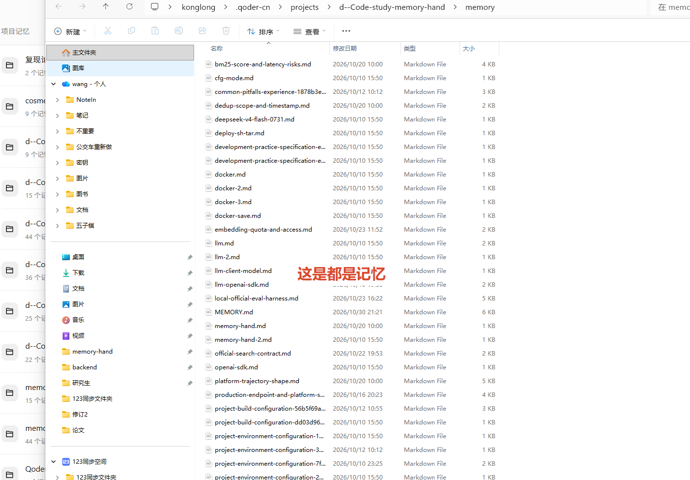
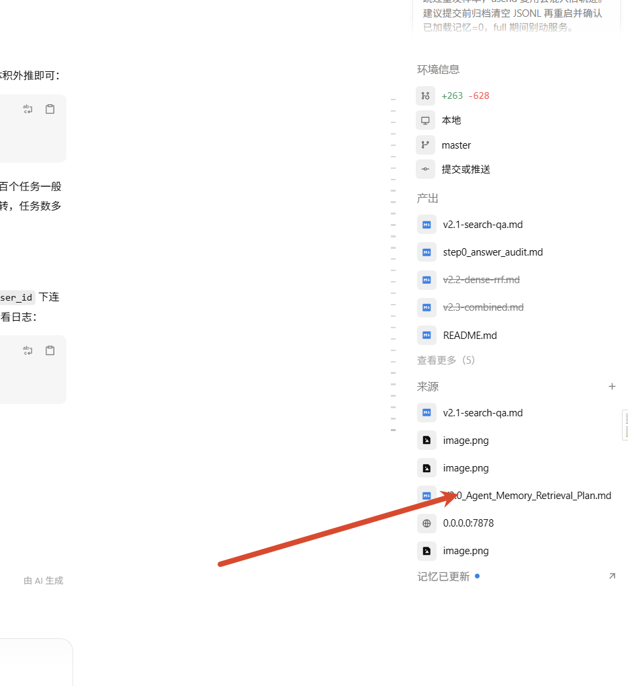

# Memory Hand — 部署信息与原始工作披露

> 本文档对应比赛提交清单中的两项：「部署信息完整」与「已披露原始工作」。
> 部署操作步骤见 [README.md](./README.md) §4；本文只写提交方需要申报的事实。

> **关键声明：本系统未使用大语言模型（LLM）。**
> `/add`、`/search`、`/health` 全链路不调用任何 LLM、Embedding 模型或外部模型 API；
> 检索与内容组装全部在本地完成（BM25 + 规则引擎）。
> `.env` 中保留的 `LLM_MODE` / `OPENAI_API_KEY` / `OPENAI_BASE_URL`（其中模型名为
> deepseek）属于历史遗留配置，**服务代码不读取**，不影响任何接口的返回值；
> 仓库中的 `src/llm_clinet.py` 也**未被任何服务或评测脚本导入**，不参与运行。

---

## 一、部署信息

### 1.1 已部署版本

| 项目 | 值 |
| --- | --- |
| 系统名称 | Memory Hand |
| 参赛赛道 | 代码记忆榜（Coding Memory） |
| 参赛组别 | 学术方法榜（开源可复现） |
| 服务实现版本 | **3.0**（V3.0-lite 实现） |
| 镜像 tag | **`memory-hand:v3_0`** |
| 代码 Commit | **`61e61df`**（master，含 `feat/v3.0-lite` 全部提交；该 commit 之后只有readme和guild文档改动，最新代码和这个版本没有区别，拉取最新版本即可） |
| API 契约 | 官方 `/add`、`/search`、`/health`，字段与路径未做任何改动 |
| 检索渲染模式 | `RETRIEVAL_MODE=v3_0`（启动日志可核；`v2_1` 为原始基线，可环境变量一键回滚） |

> 版本一致性要求：构建镜像的工作区必须干净（`git status` 为空），且 commit 与本表一致。
> 当前发布基线为 `61e61df`；若其后仍有代码提交，构建后请同步更新本行。

### 1.2 接口地址

公网 Base URL：**`http://183.66.27.21:17187`**

| 方法 | 路径 | 完整地址 | 用途 |
| --- | --- | --- | --- |
| GET | `/health` | `http://183.66.27.21:17187/health` | 平台探活，返回 `{"status":"ok"}` |
| POST | `/add` | `http://183.66.27.21:17187/add` | 写入一段会话记忆 |
| POST | `/search` | `http://183.66.27.21:17187/search` | 按 query 返回 Top-K 记忆/证据 |

说明：`17187` 是云主机公网端口映射，容器内服务监听 `7878`；两个端口同属本服务。
协议为 **HTTP**（非 HTTPS）。

### 1.3 鉴权

**无鉴权（Auth: None）**。三个接口均可直接访问，不校验 API Key / Token。
请求体与响应字段严格遵循官方契约，不做额外包装。

### 1.4 容量声明

| 项目 | 申报值 |
| --- | --- |
| 并发 | 16 RPS sustained（单 worker 单进程；检索/写入共享一把全局锁，实际串行） |
| 超时 | Search P95 ≤ 3s；Add P95 ≤ 2s；平台侧建议请求超时 30s |
| Rate Limit | 无 |
| `top_k` | 默认 100，允许范围 1–1000；实际返回条数还受字符预算约束 |
| 单 Parent content | 上限 16,000 字符；V3 按状态另有 8,000 / 8,000 / 4,000 / 4,000 / 1,000 预算 |
| 单次 `/search` 总 content | 硬上限 60,000 字符（按排名顺序花费，放不下的候选跳过） |
| `/add` 请求体 | 建议 ≤ 32 MB |
| 数据持久化 | JSONL 挂载卷 `/opt/memory-hand/data_store`，容器重启不丢 |
| 存储文件 | `data_store/v3.0/memory.jsonl`（结构化 messages）；V1.1 旧目录 `v1.1/` 不读取、不自动迁移 |
| 可用性 | 提交后至 **2026-11-04** 7×24 在线，不降级、不改契约、不改鉴权 |
| 日志 | `data_store/service.log` + 容器 stdout；Docker 日志轮转 20 MB × 5 |

性能参考：本地回放稳态检索 2–6 ms/次；某 `user_id` 首次检索需要现场构建该用户的
BM25 索引（本地约 0.4–0.9 s），随后复用内存索引。

### 1.5 运行限制

1. **单实例、单 worker**：索引与记忆常驻进程内存，不支持多副本水平扩展；多实例会各持一份索引且 JSONL 追加无跨实例协调。
2. **内存随记忆量线性增长**：启动时加载 JSONL 全量，数据量增大需相应提高容器内存。
3. **检索串行**：`/add`、`/search` 共用全局锁，单次请求毫秒级，高并发时排队而非并行。
4. **模式切换需重启**：`RETRIEVAL_MODE` 在进程启动时读取一次；改 `.env` 后需要 `docker compose up -d --force-recreate` 或重跑 `deploy.sh` 才生效。
5. **数据目录随版本固定**：本版本读写 `data_store/v3.0/memory.jsonl`；V1.1 的 `data_store/v1.1/` 不读取、不自动迁移，升级或回滚若需保留历史数据须手动复制该 JSONL。
6. **全链路无外部模型调用**：不调用 LLM、不调用 Embedding 服务、不访问外网；`.env` 中的 deepseek 等模型配置不被服务读取，不存在第三方额度、限流或超时导致检索失败的风险。
7. **负分过滤**：BM25 得分 `< 0` 的命中不返回；无任何词面证据时返回空列表（不是错误）。
8. **时区**：服务与日志时间均为 UTC。

---

## 二、已披露原始工作

### 2.1 数据集与轨迹来源

- 参赛与评测数据来自比赛平台提供的官方请求/轨迹（代码记忆榜对应
  `coding_memory_benchmark_rich` 类任务，如 astropy 仓库任务），以及平台
  实际发来的 `/add`、`/search` 请求。
- 这些数据**不随本仓库分发**：`data_store/` 已加入 `.gitignore`；仓库中的
  `evaluate/` 只包含回放脚本与评测产物，不含原始轨迹正文。
- 本项目未把任何本地构造的“标准答案补丁”或隐藏测试文本写入可提交的记忆库。

### 2.2 复用的论文与算法

| 来源 | 用途 | 使用方式 |
| --- | --- | --- |
| Robertson & Zaragoza, *The Probabilistic Relevance Framework: BM25 and Beyond* (2009) | BM25 词项打分 | 使用开源库 `rank-bm25` 的现成实现，未复制论文代码 |
| Cormack, Clarke & Büttcher, *Reciprocal Rank Fusion* (2009) | RRF 融合 | **仅实验**（V2.2 Dense+RRF），未进入提交镜像；结论记录在 `evaluate/v2.2-dense-rrf.md` |
| 官方 Agent Memory API Guide（agentmemories.ai） | `/add`、`/search`、`/health` 接口契约 | 按公开契约实现，未复用其代码 |

代码记忆榜的“Parent/证据”组织方式、状态判定与渲染规则均为本项目自行设计（见 2.5）。


### 2.3  个人方法说明（在生产中的实际形态）

检索链路只做「记忆读取与证据组装」，最终答案由平台统一生成（符合比赛红线）：

1. **写入**：`/add` 按 `request_id` 幂等去重、按 `user_id` 隔离空间，按
   `(role, content)` 哈希生成内容寻址 Parent ID，结构化写入
   `data_store/v3.0/memory.jsonl`。
2. **检索（V2.1 基线）**：消息级 BM25 + 中英混合分词；同一 Parent 取最高分
   unit 作为分数、前 3 个高分 unit 作为证据锚点；负分命中丢弃；单 Parent
   16k、单响应 60k 字符硬预算。
3. **证据组装（V3.0-lite，部署版本）**：在 V2.1 选择结果之上做三件事：
   - **问题焦点**：query 实体 ∪ 最高分锚点实体（排除次锚点，防同 Parent 多子任务交叉）；
     `summary` 锚点只贡献符号不贡献路径，`thinking/note` 锚点贡献路径。
   - **二元绑定 + 解答状态**：patch/test/summary 必须与焦点强关联（完整路径相交、
     或 ≥2 共享强符号、或 query 点名 1 + 共享 1）才渲染；据此判
     `verified_solution / patch_available / summary_only / source_only / related_only`。
   - **答案优先 + 诚实声明**：按状态决定分节顺序与预算，补丁/测试置顶并保留最终
     状态；每条返回带 `[solution_status=...]` 头与英文声明，明确“记忆里是否
     存在已验证修复”。绑不上的补丁/测试/总结一律不渲染（False Solution 门禁）。
4. **可回滚**：`RETRIEVAL_MODE=v2_1` 恢复 V2.1 原输出，不需要数据迁移。

## V_3 版本详细实现思路

V3 的改动集中在“证据如何从一段历史会话中被识别、筛选并组织成可供平台使用的上下文”。它不重新计算 BM25，也不改变 Parent 聚合和全局字符预算，而是在 V2.1 已经完成召回之后，进一步判断哪些历史片段真正属于当前问题。

### 1. 存储结构与检索结构

系统保存的基本单位是一个 Parent。Parent 保留一次请求对应的完整消息列表，以及用于持久化和隔离的元数据：

```python
mem = {
    "id": mid,
    "user_id": user_id,
    "session_id": session_id,
    "request_id": request_id,
    "messages": normalized,
    "timestamp": _messages_timestamp(normalized),
    "created_at": datetime.now(timezone.utc).strftime(
        "%Y-%m-%dT%H:%M:%SZ"
    ),
}
```

BM25 不直接以整个 Parent 作为最小检索单元，而是对消息进行分块后建立 unit。一个 unit 只记录位置和范围，不复制原始文本：

```python
units.append({
    "mem_index": mi,          # Parent 在 docs 中的下标，即 docs[mem_index]
    "message_index": msg_i,   # 消息在 mem["messages"] 中的下标
    "chunk_index": ci,        # 该消息被分成的第几块
    "start": s,               # 当前块的起始字符偏移
    "end": e,                 # 当前块的结束字符偏移
    "role": msg.get("role") or "",
})
```

这样设计有两个作用：

1. 用较小的 unit 做 BM25 召回，提高长消息中的定位精度。
2. 通过 `mem_index`、`message_index` 和字符偏移，回到 Parent 中的原始消息。

### 2. 证据组装

证据组装在**单个 Parent 内部**完成：`/search` 获得 BM25 结果后，每个 Parent 取分数最高的 unit 作为计分依据，并把前几个高分 unit 作为锚点，交给 `src/evidence_builder.py` 中的 `EvidenceBuilder` 组织成一段返回文本。

这一步只决定“放哪些历史片段、按什么顺序组织、使用多少字符预算”，不改变 BM25 分数、Parent 聚合结果或单次 `/search` 的全局预算。

```text
/search
  └─ BM25 打分（负分命中丢弃）
       └─ 每个 Parent 取最高分 unit 计分
            └─ 前 ≤3 个高分 unit 作为证据锚点
                 └─ EvidenceBuilder.render(mem, 锚点, query, 剩余预算)
                      ├─ 解析：messages → EvidenceSpan[]
                      ├─ 选择：锚点定位 + 实体关联 + 高风险门禁
                      └─ 渲染：绑定 → 解答状态 → 分节、预算与声明
```

整个流程可以概括为：

> **先把消息解析成证据，再用锚点和实体筛选证据，最后只渲染与当前问题绑定成功的内容。**

#### 2.1 解析：消息 → `EvidenceSpan`（`_spans`）

```
kind = {
    "problem": 1,   # 最多放 1 条问题描述
    "note": 1,      # 最多放 1 条笔记
    "source": 2,    # 最多放 2 条源码片段
    "error": 1,     # 最多放 1 条错误日志
    "patch": 2,     # 最多放 2 条补丁
    "test": 2,      # 最多放 2 条测试记录
    "summary": 1,   # 最多放 1 条总结
}
# tool_use JSON 的协议字段不是任务实体，参与匹配会制造假关联
_PROTOCOL_WORDS = {
    "tool_use", "tool_result", "thinking", "file_path", "old_string",
    "new_string", "replace_all", "timeout_seconds", "timeout", "description",
    "command", "content", "path", "query", "top_k", "user_id", "session_id",
    "request_id", "created_at", "message_index", "parent_id", "role", "kind",
}
```


`_spans` 逐条遍历 `mem["messages"]`，根据消息角色选择解析器，输出 `EvidenceSpan`。每个 span 记录消息下标、字符起止位置、证据类型、文件路径和强符号。

**`assistant` 消息的解析：**


1. **忽略 `thinking`。** `thinking` 是 Agent 的中间推理过程，不是已经验证的解决证据；保留它容易把过程性内容误当成答案。
2. **提取工具调用。** `_tool_call` 返回工具名称、解析后的数据和原始内容 `raw`。没有工具调用或解析失败时返回 `(None, None, None)`。
3. **识别测试调用。** 工具名称为 `bash` 或 `Bash`，且内容包含执行字段时，继续识别测试意图；命中测试特征则归类为 `**test**`，同时提取路径和强符号。
4. **识别修改调用。** 工具名称为 `Edit`、`Write` 或 `MultiEdit` 时，提取修改前后的内容并还原 diff，归类为 **`patch`。**
5. **识别总结。** 对话中最后一条较长的普通 assistant 文本视为 **`summary`**，同一个 Parent 只保留最后一条总结。
6. **提取实体。** 从工具调用的原始内容中提取文件路径、强符号和出现次数最多的路径，供后续关联使用。

**`user` 消息的解析：**

1. 如果消息不是以 `[tool_result]` 开头，就归类为 **`problem`**。**这覆盖了大多数普通用户问题。
2. 如果是 `tool_result`，继续判断内容属于 **`error`、`test` 还是 `source`：**
   - 包含 `Traceback` 或非零 `exit code`，归类为 `error`；
   - 属于测试执行或包含测试统计信息，归类为 `test`；
   - 包含带行号的代码，或出现 `class`、`def` 等源码结构，归类为 `source`；
   - 以上条件都不满足时丢弃，不把它当作有效证据。

当前源码识别主要覆盖 Python、Java、C++ 等包含 `class` 或 `def` 结构的代码，尚未专门扩展 Go、前端等语言的规则。


#### 2.2 选择：锚点 + 实体关联（`_select`）


`_select` 负责回答一个问题：**当前 Parent 中哪些证据真正与本次 query 相关？**

**第一步：取出解析结果。** 使用 `_spans` 生成的全部 `EvidenceSpan`。


**第二步：用锚点定位证据。** 遍历 `anchor_units`，判断每个锚点的字符区间与哪些 span 重叠。锚点可能只覆盖长消息的一部分，而 span 通常覆盖完整消息，因此需要比较字符范围，不能只比较消息是否相同。


**第三步：生成兜底 `note`。** 如果锚点没有命中已解析证据，通常说明 BM25 命中了被忽略的 `thinking`，或命中了一段暂时无法分类的文本。此时将命中的原文生成 `note`，加入候选证据。


**第四步：合并重复命中。** 多个锚点命中同一个证据，或命中同一消息的相邻区间时，合并重复 span，避免重复渲染。


**第五步：生成 `relation`。** 将用户 query 中的实体与锚点证据中的关键实体合并，得到当前 Parent 的关联实体集合。


**第六步：执行防御性过滤。** 再次检查证据是否存在实体关联、是否属于同一任务或主文件分组，以及 `patch`、`test`、`error`、`summary` 等高风险证据是否完整。


**第七步：计算相关性分数并排序。**

| 命中条件 | 加分 |
| --- | ---: |
| 命中 query 中的一个实体 | +3 |
| 命中 relation 中的一个实体 | +2 |
| 主文件出现在 relation 中 | +2 |

最后按分数排序，并返回渲染阶段需要的信息：

```
{
    "related": related,
    "score": score,
    "relation": relation,
    "relevant": relevant,
    "anchor_spans": anchor_spans,
    "anchor_ranges": anchor_ranges,
    "query_paths": query_paths,
    "query_strong": query_strong,
}
```

#### 2.3 渲染：绑定 → 状态 → 分节（`_render_v3`）

`_render_v3` 不会把 `_select` 找到的所有证据直接拼接返回，而是继续执行绑定和状态判定。这是 V3 防止 False Solution 的核心步骤。

**第一步：确定问题焦点。**

从锚点中取分数最高的一个作为当前焦点。一个 Parent 最多可以有三个锚点，但只有最高分锚点参与最终焦点构建，避免次高锚点属于另一个子任务时把两条任务线混在一起。焦点由锚点关联的文件路径和强符号组成。

**第二步：绑定 `patch`。**

补丁只有在与当前焦点属于同一个解决过程时才会被保留。满足以下任一条件，才认为补丁绑定成功：

1. 补丁与焦点包含相同的完整文件路径，要求是带 `/` 的完整路径；
2. 补丁与焦点至少共享两个强符号；
3. 补丁包含 query 明确提到的一个强符号，并且同时与焦点共享另一个符号。

只共享裸文件名不算绑定依据，因为不同目录下可能存在同名文件。绑定失败的补丁不会渲染，避免把其他任务的修改误报为当前问题的解决方案。

**第三步：绑定 `test` 和 `summary`。**

`test` 和 `summary` 使用同样的焦点关联规则继续绑定。`test` 还必须能够识别出通过状态，例如包含 `pass` 或测试通过统计；`summary` 也不能仅因为位于同一个 Parent 中，就被当成当前问题的总结。

只有与当前问题确实关联的补丁、测试和总结，才有机会进入最终返回文本。

**第四步：判定解答状态。**

完成绑定后，按照以下优先级判断当前 Parent 的状态：

| 条件                           | 状态                | 实际含义                               |
| ------------------------------ | ------------------- | -------------------------------------- |
| 存在绑定的 patch 和通过的 test | `verified_solution` | 历史上有补丁及通过的测试记录           |
| 存在绑定的 patch               | `patch_available`   | 有历史补丁，但缺少被认可的通过测试     |
| 存在绑定的 summary             | `summary_only`      | 只有可绑定的解决总结，没有可用补丁     |
| 存在 source/error/problem/test | `source_only`       | 有问题相关证据，但没有前面几种解决方案 |
| 其他情况                       | `related_only`      | 只有一般相关内容                       |


状态不是对代码正确性的重新验证，而是对“记忆中保存了什么证据”的诚实描述。例如，`patch_available` 只表示记忆里存在相关补丁，并不表示当前代码一定已经通过测试。

**第五步：按状态决定分节顺序和预算。**

答案性证据优先出现在前面，避免问题描述、源码或错误日志占满预算后，真正有用的补丁和测试无法返回。

```python
STATUS_ORDER = {
    "verified_solution": (
        "problem", "patch", "test",
        "source", "error", "summary"
    ),
    "patch_available": (
        "problem", "patch", "test",
        "source", "error", "summary"
    ),
    "summary_only": (
        "problem", "summary", "source",
        "error", "test"
    ),
    "source_only": (
        "problem", "source", "error",
        "test", "note"
    ),
    "related_only": (
        "note", "problem"
    ),
}
```

具体渲染时还会受到每种证据类型的条数上限、单个 Parent 的状态预算，以及单次 `/search` 的全局预算限制。补丁和测试保留最后两条，尽量展示修改或验证后的最终状态；无法绑定的 `patch`、`test` 和 `summary` 一律不输出。

每个候选结果还会带有 `solution_status` 头部和英文声明，明确记忆中是否存在已经验证的修复。如果状态头和声明都无法完整放入剩余预算，则放弃该候选，继续尝试后面的 Parent，而不是返回截断或具有误导性的证据。

### 3. 版本回滚

如果将 `RETRIEVAL_MODE` 设置为 `v2_1`，系统会恢复 V2.1 的原始检索与渲染路径。回滚只改变检索渲染逻辑，不需要迁移已有数据。


## 个人心得

在记忆检索方案的探索过程中，我先后尝试了 **BM25** 和 **BM25 + Dense Retrieval** 两种方法，但都未能解决 Smoke 测试中的问题。进一步分析 Smoke 数据后发现，部分测试对应的记忆中实际上并不包含解决问题所需的答案。因此，单纯依靠检索方法，无论如何优化召回和排序，都无法从缺失的信息中找到答案。除非针对测试数据专门定制记忆内容，但这样就失去了研究通用记忆检索方法的意义。


对于BM25+向量检索，再加上rrf，尝试过。但是，实验发现，融合后的高排名锚点与单独使用 BM25 时基本一致，没有带来明显收益。因此，最终移除了 Dense Retrieval 和 RRF 相关逻辑。这部分实现可以在 `v_2.1` 分支中找到。


本方法的是纯bm25来做的，利用了很多正则。这些规则主要来自个人工程开发经验，以及对官方提供的 AEC （好像是，有点忘了）示例数据的分析，本质上具有较强的经验性和数据依赖性。一旦脱离预设的数据模式，整个方法基本就会退化为普通的 BM25 检索。**比如直接把test字段换为中文，就不能检索了**


实际上，当前方案更多是在现有检索框架上进行局部优化，虽然能够带来一定改进，但并没有实现本质性的突破。如果当前记忆中，没有答案，怎么检索都不行，比如smoke数据


后续如果要继续深入，就必须加入**LLM**，但是本比赛**限制gpt模型**，受限于网络，支付环境等各种条件，未尝试这个方向。


在实际使用一些代码 Agent 工具（如 oder、Codex）的过程中，观察到它们在处理工程类任务时，往往会将重要的项目背景、实现过程和经验总结整理成 Markdown 记忆文件。当用户再次提出相关问题时，Agent 可以直接利用这些经过组织的记忆，而不必完全依赖从原始历史对话中重新检索和还原信息。







后续要进一步，大概率必须使用llm模型做记忆抽取。


从相关研究来看，已有不少工作开始关注记忆抽取、结构化组织以及动态更新。例如 *A-MEM: Agentic Memory for LLM Agents*，其核心思路可以概括为：

$$
[
\text{新信息}
\rightarrow
\boxed{\text{结构化 Memory Note}}
\rightarrow
\boxed{\text{建立记忆连接}}
\rightarrow
\boxed{\text{更新旧记忆}}
]
$$

与直接保存原始对话、在检索阶段依靠规则重建上下文相比，这类方法更加重视记忆的形成过程：先从交互信息中提取有价值的内容，将其组织为结构化的记忆单元，再建立记忆之间的关联，并随着新信息的出现持续更新已有记忆。


因此，如果后续希望在 Agent Memory 方向继续深入，我认为更值得探索的是**引入 LLM 参与记忆的抽取、组织、关联与更新**，而不只是继续优化 BM25 或 Dense Retrieval 的排序策略。单纯检索排序，感觉没有很大的提升。尤其是通过正则提取，非常依赖数据本身。


##   未使用项声明

部署版本是V3_0 **不使用**以下组件或能力：

- **大语言模型（LLM）**：无 OpenAI / DeepSeek / 通义等任何模型调用；环境变量中的 deepseek 配置未被读取。
- **Embedding / 向量检索**：生产链路无 Dense 召回、无向量数据库（FAISS/Milvus 等）。
- **外部检索或 RAG 框架**：无 LangChain / LlamaIndex，无第三方 rerank 服务。
- **自训练、微调模型或私有模型权重**：无。
- **跨样本共享状态**：无；索引与缓存全部按 `user_id` 隔离。

`/search` 的输出完全由 `src/memory_engine.py` 与 `src/evidence_builder.py` 的本地
BM25 打分和规则化证据组装决定；最终答案由平台统一生成，本服务不生成答案。
